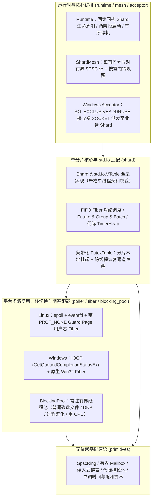
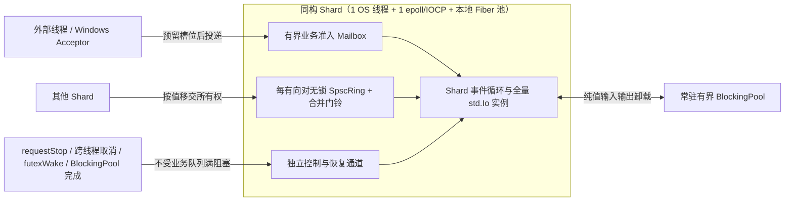
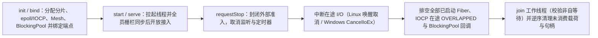

# AGENTS.md

默认使用中文沟通与编写文档，路径、命令、代码与标识符保留原文。
本文件只定义 `islet` 的全局**工程准则**、**架构边界**、**Shared-Nothing 并发与生命周期契约**及 **Zig 代码规范**，不记录目录清单、实现流水或单点修复。`README.md` 面向使用者提供最短接入与验证入口；同一事实只维护一处，项目文档冲突时以本文件为准。

---

## 1. 工程与协作准则

- **保护现场**：修改前检查 `git status`，保留用户已有改动；目标环境受限或无关改动导致失败时保留现场并如实报告，不擅自回退、覆盖或夹带无关修改。
- **自主决策**：能由上下文、现有契约或操作系统规范推导时直接执行；仅在存在实质性歧义或重大架构权衡时提出单个必要问题。
- **优先级顺序**：正确性与并发安全 > 长期可维护性 > 经实测证明的性能与内存收益。
- **最小抽象（Less is More）**：能删则删、能简则简，至少两个真实调用方共享才提取复用抽象；严禁假想扩展点、单调用方泛型/策略层、无状态包装或将纯同步计算伪装成挂起操作。
- **唯一契约与闭环迁移**：同类能力、状态机与系统调用封装只保留唯一入口与单一主链；拆分、合并或改名必须一次迁移全部符号、调用方、测试与构建配置，删除旧文件、兼容别名、死代码与只写不读统计，不引入无外部标准依据的内部版本号或代次后缀。
- **纯后端公开边界**：包根（`src/root.zig`）仅对外暴露 `Runtime` / `Shard` 生命周期入口与 `std.Io` 适配实例，**严禁暴露任何内部子模块 API**（如 `SpscRing`、`Mailbox`、`ShardMesh`、`TimerHeap`、`BlockingPool`、`Epoll`、`Iocp`、`Fiber`、`Acceptor`）；跨分片协作、网络接入与文件/同步操作一律经标准 `std.Io` 契约透明承载。
- **文件职责与拆分边界**：一个文件承载一个内聚职责（完整的类型族、平台多路复用器或同步原语），不设机械行数阈值，巨型单文件与碎片化壳文件同等违规；仅当同时承载两个以上独立演进状态机、或消除真实依赖传染且拆后可独立验证时才拆分，名实不符优先改名；共享同一组私有不变量且总共同修改的零散文件必须合并。
- **遵循标准与系统契约**：严格遵循 Zig `0.17.1` `std.Io` 接口语义、Linux man-pages（`epoll(7)`、`eventfd(2)`、`socket(7)`）与 Microsoft Win32 / Winsock2 / IOCP 规范，区分内核保证与平台差异，不以主观臆断代替系统契约。
- **源码与产物隔离**：源码、依赖缓存与生成产物严格分离；**严禁向 `/tmp` 写入构建缓存、测试临时文件或验证产物**（防内存文件系统耗尽），临时文件统一置于仓库 `build/` 或 `.zig-cache/` 下并在验证后立即清理。

---

## 2. 架构分层与平台拓扑

| 模块层级 | 负责 | 不负责 |
| :--- | :--- | :--- |
| `primitives` | 无锁 `SpscRing`、有界准入队列、侵入式节点、代际槽位、饱和时长与向上取整换算 | 线程创建、系统 I/O、Fiber 切栈、`std.Io` 语义 |
| `fiber` | Linux Guarded Stack 上下文切换、Windows Win32 Fiber 封装、栈水位线回收支撑 | 调度策略、取消状态机、多路复用事件等待 |
| `poller` | Linux `epoll` + `eventfd` 就绪驱动、Windows `IOCP` 完成包收割与门铃唤醒 | 跨分片通信、业务准入、`Group` / `Future` 编排 |
| `blocking_pool` | 常驻有界工作线程、槽位准入、独立值闭包执行与完成回传 | 访问任何 Shard 私有状态、池内自等待、无界排队 |
| `shard` | 单线程事件循环、Fiber 调度、定时器最小堆、全量 `std.Io.VTable` 契约落地 | 跨 Shard 窃取任务、动态增删线程、全局连接共享 |
| `mesh` / `acceptor` | Shard 间有界 SPSC 载荷移交、Windows 独占监听接收裸 `SOCKET` 分发 | 业务协议解析、代替目标 Shard 提前绑定 IOCP |
| `runtime` | 固定 Shard 集合构造、两阶段启动栅栏、跨分片网格装配、全局停机与 `join` | 进入稳态 I/O 热路径、持有分片可变数据面对象 |

- **单向无环依赖（DAG）**：模块 `@import` 严格保持自上而下单向无环；平台条件编译（`builtin.os.tag`）收敛在 `poller`、`fiber` 与系统调用转换层，禁止向通用调度与基础原语层扩散平台分支。
- **平台监听接入拓扑（经 `std.Io` 透明承载）**：
  - **Linux（`epoll`）**：各业务 Shard 调用 `netListenIp`（`reuse_address` 置 `SO_REUSEADDR | SO_REUSEPORT`）在各自事件循环独立绑定监听套接字并直接 `accept4`（置 `SOCK_NONBLOCK | SOCK_CLOEXEC`），由内核分发连接，零跨线程句柄移交。
  - **Windows（`IOCP`）**：因无 `SO_REUSEPORT` 负载均衡且已绑定 IOCP 的内核 `SOCKET` 不可重绑至其他完成端口，多 Shard `Runtime` 下启用 `reuse_address` 的 `netListenIp` / `netAccept` 在内部透明委托独立轻量 **Acceptor 线程**（以 `SO_EXCLUSIVEADDRUSE` 独占绑定，经 `AcceptEx` 接收**未关联任何 IOCP 的裸 `SOCKET`**，先预留目标 Shard 有界准入槽位再按值移交，由目标 Shard 在 `netAccept` 接管时完成**首次且唯一一次** IOCP 绑定，被拒时由 Acceptor 立即关闭并计入拒绝统计）；单 Shard 或非共享监听直接关联当前 Shard 自身 IOCP。

---

## 3. Shared-Nothing 分片与跨线程契约

- **固定同构分片**：Shard 数量在 `Runtime` 初始化期固定，运行期严禁增删；所有业务 Shard 完全同构，无主从或下标特权逻辑，单线程严禁嵌套运行多个 Shard。
- **严格单线程亲和（`shard.io()`）**：`Shard` 暴露的 `std.Io` 实例通过 `threadlocal` 当前分片指针做 $O(1)$ 校验；除显式允许跨线程触发唤醒的 `futexWake` 外，`async`、`concurrent`、`await`、`cancel`、`group*`、`operate`、`batch*`、`sleep`、`net*`、`file*`、`dir*` 等全部 `VTable` 入口**仅限所属 Shard 线程调用，跨线程调用一律 `@panic`**。
- **禁窃取与终生亲和**：严禁跨 Shard 窃取就绪队列或空闲 Fiber 栈（区别于标准库 `std.Io` 默认 M:N 窃取模型）；Fiber、`Future`、`Group`、`Batch`、连接、文件包装与定时器终生固定在创建或接管它的 Origin Shard，私有指针与借用切片严禁跨线程逃逸。
- **跨线程共享白名单**：全局仅允许启动期封存的只读配置/快照、每有向 Shard 对独占的有界 `SpscRing`、外部投递有界 `Mailbox`、独立控制/恢复通道、条带化 `FutexTable` 等待桶及有界 `BlockingPool`；严禁用互斥锁或原子引用计数跨 Shard 共享活跃连接、读写缓冲或 Fiber 池。
- **SPSC 网格与门铃合并**：`SpscRing` 容量固定为 2 的幂，生产者（`tail`、`cached_head`）与消费者（`head`、`cached_tail`）按 `std.atomic.cache_line` 对齐隔离，单调递增索引消除 CAS 与 ABA，槽位采用未初始化裸存储防空闲缺页；跨分片消息必须按值转移所有权并附带未消费清理函数；唤醒经 `seq_cst` 屏障与原子 `armed` 标志合并，每轮休眠最多触发一次 `eventfd` 写或 `PostQueuedCompletionStatus`。
- **准入优先与失败退回负载**：有界 `Mailbox` 与 `BlockingPool` 投递先预留容量槽位再构造或接管任务；队列满或停机封闭时立即返回显式状态并将未消费负载原样退回调用方，禁止静默丢弃或退化为无界堆积。
- **独立控制与恢复通道**：停机信号、定时器/外部取消通知、`futexWake` 唤醒与 `BlockingPool` 完成回传走预留节点或侵入式链表的独立通道，保证业务队列满载时取消、唤醒与回收永不死锁。
- **同 Shard 延迟唤醒防栈递归**：同分片内的 Fiber 唤醒、锁释放或条件通知统一将目标 Fiber 挂入本 Shard 就绪队列尾部，由事件循环后续轮次切换执行，严禁在解锁或回调中途直接切栈造成深层栈递归。
- **全量 `VTable` 与阻塞卸载边界**：完整实现 `std.Io.VTable` 全部契约；套接字、管道、TTY、`pidfd`（Linux）及重叠句柄（Windows）走本 Shard 原生非阻塞/异步多路复用，Linux 普通磁盘文件（`epoll` 返回 `EPERM`）、阻塞型目录元数据、`netLookup`、子进程孵化等无法异步挂入多路复用器的调用统一经 `BlockingPool` 卸载并挂起当前 Fiber，严禁阻塞 Shard 事件循环线程，且 `BlockingPool` 内部严禁自等待。

---

## 4. Fiber、多路复用与异步生命周期

- **双平台原生 Fiber 契约**：
  - **Linux**：使用 `mmap` 分配有界栈并在低地址端强制设置至少一页 `PROT_NONE` Guard Page 捕获栈溢出，按目标架构 ABI（`x86_64` / `aarch64`）在用户态无系统调用切换被调用者保存寄存器与浮点控制状态。
  - **Windows**：工作线程启动时经 `ConvertThreadToFiberEx` 转为调度主纤程，任务栈由 `CreateFiberEx` / `SwitchToFiber` / `DeleteFiber` 管理，完整维护 `NT_TIB` 栈界、`__chkstk` 探针、SEH 异常展开链与非易失 `XMM` 寄存器，禁止手写破坏 TEB 不变量的裸汇编切栈。
- **Linux `epoll` 就绪驱动**：每 Shard 独占单个 `epoll_fd` 与 `eventfd`；本地按 `fd` 维护槽位及独立的读/写侵入式等待队列，缓存已注册事件掩码消除重复 `epoll_ctl`；I/O 先走非阻塞系统调用快路径，仅遇 `WouldBlock` 才挂起当前 Fiber，由单调时钟最小堆最近截止期直接驱动 `epoll_wait` 超时（禁止每任务创建 `timerfd`）。
- **Windows `IOCP` 完成驱动与 `OVERLAPPED` 生命周期铁律**：每 Shard 独占单个并发度为 1 的 IOCP 句柄，经 `GetQueuedCompletionStatusEx` 批量收割完成包并结合最小堆最近截止期休眠；**任何在途 I/O 的 `OVERLAPPED` 及其内核读写缓冲在对应完成包从 IOCP 弹出前归内核独占借用**——遇到取消或超时时，必须先调 `CancelIoEx` 并**不可取消地等待该完成包返回收割**后，方能释放 `Batch` 槽位或销毁 Fiber 栈帧，严禁提前弹出栈帧或复用内存。
- **结构化并发收束**：未启动任务可零成本丢弃；一旦经 `Io.async`、`Io.concurrent`、`Group.async`、`Group.concurrent` 启动或向 `Io.Batch` 提交在途操作，所有者退出前必须调用 `await` 或 `cancel` 完整收束，销毁仍含在途任务的宿主或静默分离任务直接 `@panic`。
- **取消点与 `CancelProtection`**：严格实现 `std.Io` 单次确认取消模型——仅返回错误集含 `error.Canceled` 的原语在 `.unblocked` 态充当取消点，触发一次 `error.Canceled` 后置为已确认；清理阶段须用 `swapCancelProtection(.blocked)` 屏蔽二次中断，或用 `recancel()` 显式重武装取消请求。
- **代际槽位（`slot + generation`）**：定时器注册与跨步等待槽统一采用槽位池配单调递增 `generation`；取消仅使原代际失效而不在最小堆中做线性查找删除，堆顶到期弹出时惰性跳过陈旧代际项，根除 ABA 误唤醒。
- **锁外执行与防重入终结**：在 `Mailbox`、`FutexTable` 条带锁与 `BlockingPool` 队列锁内部**仅做指针交换或整链摘取**，回调执行、负载清理与内核门铃系统调用一律在锁外完成；重置外部包装指针前先置空再销毁目标，触发可能销毁宿主的完成逻辑前先将状态快照到栈局部。
- **原子内存序可证明**：每处原子读写必须明确其保护的状态及 `release` / `acquire`（或门铃 `seq_cst`）配对关系，禁止用原子变量掩盖所有权归属错误。

---

## 5. 内存治理、超时与资源预算

- **显式 `Allocator` 与零额外池包装**：统一通过参数显式注入 `std.mem.Allocator`；禁止像标准库 `Uring.zig` 那样在热路径包一层全局 `backing_allocator_mutex`，也不在注入分配器之上叠加自定义 slab、尺寸类内存池或隐式全局池。
- **有界 Fiber 栈与水位线回收**：Fiber 栈容量显式可配并维持合理有界默认值（杜绝数十 MiB 巨型固定栈）；每个 Shard 维护本地无锁空闲 Fiber 栈单链表，水位线内 $O(1)$ 复用，超出高水位或进入空闲收缩时立即归还底层分配器 / 操作系统。
- **稳态热路径零堆分配**：`Io.Batch` 直接复用调用方提供的 `[]Operation.Storage`；`Io.Group` 与 `epoll` / `futex` 等待队列全部使用驻留于 Fiber 帧或栈上的侵入式节点；路径零结尾转换、Windows `UTF-16LE` 路径转换及 scatter/gather `iovec` / `WSABUF` 组装优先使用栈上固定缓冲（SBO），仅超长输入按需退回堆分配并立即 `defer` 释放。
- **单调时钟、饱和算术与向上取整**：内部定时器与截止期统一基于单调时钟（`Io.Clock.awake`）；时长加减采用饱和算术（`+|` / `-|`）防止溢出；将正纳秒剩余时长转换为毫秒级内核等待参数（`epoll_wait` / `GetQueuedCompletionStatusEx`）时**一律向上取整（ceil）**，禁止截断取整引发零毫秒忙等自旋。
- **有界配额与脏资源即刻淘汰**：所有准入队列、挂起任务数、句柄表与外部输入缓冲均须受显式上界约束，严禁按外部声明长度一次性预分配；任何发生超时、取消中断、半关闭残余不明或底层 I/O 错误的复用资源必须在收尾阶段立即关闭淘汰。

---

## 6. Zig 代码风格与错误模型

- **唯一格式化标准**：全仓统一 LF 行尾（`.gitattributes`），格式完全交由 `zig fmt` 裁决，`zig fmt --check` 必须零差异通过，禁止手写列宽折行对抗格式化器。
- **标识符与文件命名契约**：

| 语法元素 | 命名风格 | 正例 / 规范 |
| :--- | :--- | :--- |
| 类型（`struct` / `enum` / `union` / `opaque`）及返回类型的函数 | `PascalCase` | `Shard`、`SpscRing`、`TimerHeap`、`BlockingPool` |
| 以顶层结构体为根的文件 (`const Self = @This()`) | `PascalCase.zig` | `Shard.zig`、`Epoll.zig`、`Iocp.zig`、`SpscRing.zig` |
| 纯函数/原语命名空间文件 | `snake_case.zig` | `root.zig`、`fiber.zig`、`time.zig` |
| 函数与方法 | `camelCase` | `requestStop`、`tryPush`、`scheduleTimer` |
| 局部变量、参数、结构体字段、枚举/联合 tag | `snake_case` | `shard_id`、`cached_head`、`.queue_full` |
| 错误集名称与错误项 | `PascalCase` | `InitError`、`error.QueueFull`、`error.Canceled` |

- **命名禁项与外部保留**：禁用 `Manager`、`Helper`、`Processor`、`Util`、`Data`、`handle`（泛指动作）及无上下文单字母缩写；`std.Io.VTable` 回调函数名、POSIX 与 Win32 系统 API 及协议常量保留上游标准拼写，不做仅改名的薄包装。
- **四级结果与错误形状**：

| 结果类别 | Zig 表达形状 | 典型场景与约束 |
| :--- | :--- | :--- |
| **正常进展、准入与背压** | 显式状态 `enum` 或带退回载荷的 `union(enum)` | `SpscRing` 满、`Mailbox` 背压/已关闭、非阻塞探针 `would_block`（背压不是异常错误） |
| **预期外部 / I/O / 取消 / 超时错误** | 精确具名错误集 `Error!T`（**禁公开或跨模块写 `anyerror`**） | `error.Canceled`、`error.Timeout`、`Io.Operation.*.Error`、`Allocator.Error`；未知系统码经 `unexpectedErrno` / `unexpectedStatus` 归为 `error.Unexpected` |
| **内核报告的调用契约缺陷** | `errnoBug`（安全模式断言，发布模式归 `error.Unexpected`） | 对受管有效句柄收到 `EBADF`、`EFAULT` 或非法内部标志 `EINVAL` |
| **生命周期与线程亲和违规** | 无条件 `@panic` | 跨线程调用 `shard.io()`、销毁含未收束任务的宿主、自等待 `join`、在途 `OVERLAPPED` 未排空即释放 |

- **初始化回滚与地址固定**：`init` 成功即进入合法可用态，多步资源申请每步紧跟 `errdefer` 精确逆序回滚，`deinit` 末尾将宿主置 `undefined` 暴露悬垂访问；凡被内核（`IOCP` / `epoll`）、工作线程或侵入式链表持有指针的对象必须地址固定（通过 `*Self` 原地初始化，严禁按值移动拷贝）；借用切片不得跨越异步挂起点留存至其他线程。
- **精炼注释**：模块 `//!` 与公开 API `///` 只写职责边界、线程亲和、所有权移交、取消语义与平台前置条件；行内 `//` 只解释非直观不变量、内存序配对与内核边界行为，绝不复述代码。

---

## 7. 构建、验证与交付门槛

- **唯一构建入口**：工具链由根 `mise.toml` 固定（`zig = "0.17.1"`），构建与测试图统一收敛在根 `build.zig` 与 `build.zig.zon`，严禁引入 Python / Node / 复杂 Shell 构建胶水脚本。

| 验证维度 | 规范与通过门槛 |
| :--- | :--- |
| **格式与多目标交叉编译（`zig build check`）** | 每次代码改动必须通过 `zig fmt --check` 及 `x86_64-linux`、`aarch64-linux`、`x86_64-windows`、`aarch64-windows` 四目标测试图编译校验，确保 Linux `epoll` 与 Windows `IOCP` 双后端零编译腐化 |
| **本机单元与内存守恒测试（`zig build test`）** | 统一使用 `std.testing.allocator` 校验零内存泄漏，覆盖边界条件、状态转换、满队退回与初始化失败回滚，保持完全确定性与并发隔离 |
| **真实内核 E2E 验证** | 网络（TCP/UDP 回环分段、半关闭、重置、背压）、管道/文件、定时器、跨 Shard `SpscRing` / `Mailbox`、`BlockingPool` 卸载及停机回收必须走真实内核句柄验证，禁止用 mock 假实现代替端到端路径 |
| **缺陷修复与性能结论** | 缺陷修复先补可复现回归测试再改实现；性能优化须由同机同条件交错实测数据支撑，不凭主观猜测引入复杂分支 |
| **纯文档改动** | 校验章节层级、链接、Mermaid 语法与当前构建命令一致性，不跑无关重型测试 |

- **交付纪律**：Git 提交保持仓库既有作者配置，提交信息使用简短准确的英文；验证通过后仅提交本任务改动（不强推、不擅自操作 Tag/Release）；处于用户指定的阶段性确认节点时，先完成本地全量验证并等待确认后再推进下一阶段。
