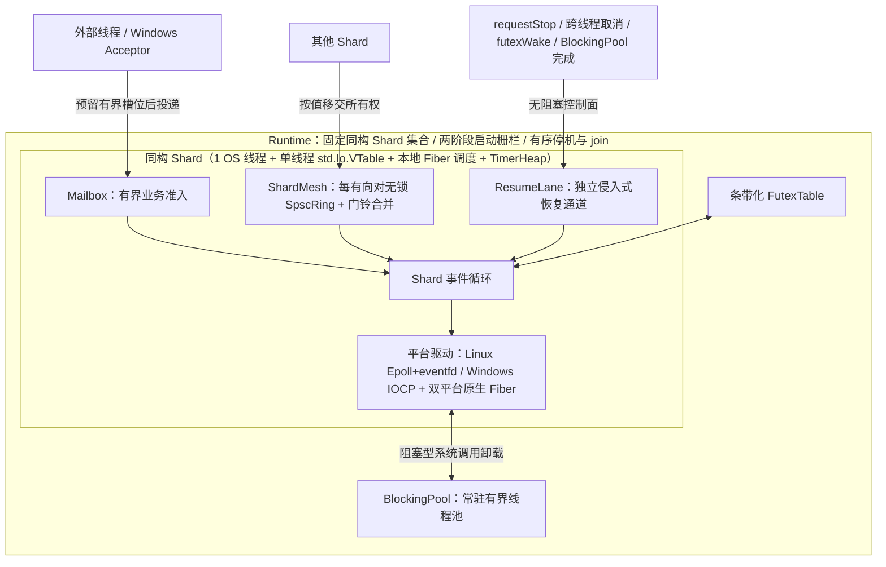

# AGENTS.md

**最高优先级铁律：Less is More > 正确性与并发安全 > 长期可维护性 > 经实测证明的性能与内存收益。**
本文档按重要度降序定义 `islet` 的工程契约（越靠前优先级越高；冲突时前序条款优先于后序条款，本文档优先于其他文档）。默认使用中文沟通与编写文档，路径、命令、代码与标识符保留原文；`README.md` 仅面向使用者维护最短接入与验证入口，同一事实只维护一处，不记录目录清单或变更流水。

---

## 1. 核心铁律：Less is More 与最小边界

1. **能删则删、能简则简**：单一机制能满足契约时严禁叠加平行通道或复杂快慢双轨分支；至少两个真实调用方共享才提取复用抽象；严禁假想扩展点、单调用方泛型/策略层、无状态薄包装，或将纯同步计算伪装成异步挂起。
2. **纯后端极简公开边界**：包根（`src/root.zig`）**仅**对外暴露唯一生命周期入口 `Runtime`，严禁暴露任何内部子模块（`Shard`、`SpscRing`、`Mailbox`、`ShardMesh`、`TimerHeap`、`FutexTable`、`BlockingPool`、`Epoll`、`Iocp`、`fiber`、`Acceptor`）或标准库类型别名；一切并发、网络、文件与同步能力经标准 `std.Io` 透明承载。
3. **唯一主链与闭环清理**：同类能力、状态机与系统调用封装只保留唯一入口；拆分、合并或改名须一次迁移全部调用方、测试与构建配置，彻底删除旧文件、兼容别名、死代码与只写不读统计，严禁引入无外部标准依据的代次后缀。

---

## 2. 正确性与并发安全契约

1. **严格单线程亲和与禁窃取（Shared-Nothing 根基）**：`Runtime.init` 固定同构 Shard 数量（运行期禁增删、无主从特权、单 OS 线程禁运行多个 Shard）；`Shard` 暴露的 `std.Io` 经 `threadlocal` 做 $O(1)$ 校验——除允许跨线程唤醒的 `futexWake` 外，其余全部 `VTable` 入口**仅限所属 Shard 线程调用，跨线程调用一律 `@panic`**；严禁跨 Shard 窃取任务或空闲栈，Fiber、`Future`、`Group`、`Batch`、句柄包装与定时器终生固定在 Origin Shard，私有指针与借用切片禁跨线程逃逸。
2. **结构化并发与单次取消确认**：已启动的 `Future`、`Group` 任务及 `Batch` 在途操作在宿主退出前必须 `await` 或 `cancel` 完整收束，未收束销毁宿主直接 `@panic`；严格遵循 Zig `0.17.1` `std.Io` 单次确认取消语义——仅错误集含 `error.Canceled` 的原语在 `.unblocked` 态充当取消点，触发一次后置为已确认，清理阶段须用 `swapCancelProtection(.blocked)` 屏蔽二次中断或用 `recancel()` 重武装。
3. **遵循系统契约与平台多路复用 / Fiber 铁律**：严格依据 Zig `0.17.1` `std.Io`、Linux man-pages（`epoll(7)`、`eventfd(2)`、`socket(7)`）与 Win32 / Winsock2 / IOCP 规范实现，禁凭臆断抹平平台差异：
   - **Windows `IOCP` 与 `OVERLAPPED` 铁律**：每 Shard 独占并发度为 1 的 IOCP（`GetQueuedCompletionStatusEx`）；**任何在途 I/O 的 `OVERLAPPED` 及其读写缓冲在对应完成包从 IOCP 弹出前归内核独占借用**——取消或超时必须先调 `CancelIoEx` 并**不可取消地等待该完成包收割**后，方能释放槽位或弹出栈帧。多 Shard 下启用 `reuse_address` 的监听（因无 `SO_REUSEPORT` 负载均衡且已绑定 IOCP 的 `SOCKET` 不可重绑）透明委托独立轻量 **Acceptor 线程**（`SO_EXCLUSIVEADDRUSE` 独占绑定，`AcceptEx` 接收**未关联任何 IOCP 的裸 `SOCKET`** 经有界准入移交目标 Shard，在 `netAccept` 完成**首次且唯一一次** IOCP 绑定，满载被拒立即关闭）；单 Shard 或非共享监听直连本 Shard IOCP。
   - **Linux `epoll` 铁律**：每 Shard 独占单个 `epoll_fd` 与 `eventfd`，各 Shard 独立绑定监听（`reuse_address` 置 `SO_REUSEADDR | SO_REUSEPORT`）并直接 `accept4`（置 `SOCK_NONBLOCK | SOCK_CLOEXEC`），零跨线程句柄移交；I/O 先走非阻塞快路径，遇 `WouldBlock` 才挂入按 `fd` 隔离的读写侵入式队列；**关闭 `fd` 前必须先注销 `epoll` 并递增槽位代际**防句柄复用串扰。
   - **双平台原生 Fiber**：Linux 使用 `mmap` 有界栈并在低地址端设 `PROT_NONE` Guard Page，按 `x86_64` / `aarch64` ABI 在用户态切换被调用者保存寄存器与浮点状态；Windows 经 `ConvertThreadToFiberEx` / `CreateFiberEx` / `SwitchToFiber` / `DeleteFiber` 完整维护 `NT_TIB` 栈界、`__chkstk`、SEH 展开链与非易失 `XMM` 寄存器，严禁手写破坏 TEB 的裸汇编。
4. **跨线程共享白名单、有界背压与独立恢复面**：全局仅允许封存只读配置、每有向 Shard 对有界 `SpscRing`（按值移交所有权并支持未消费清理）、有界 `Mailbox`、独立 `ResumeLane`、条带化 `FutexTable` 及常驻有界 `BlockingPool`（严禁跨 Shard 共享活跃连接、读写缓冲或 Fiber 池）；业务投递先预留有界槽位，满载或停机封闭时立即退回未消费载荷，禁静默丢弃或无界堆积；停机、取消、`futexWake` 与 `BlockingPool` 完成回传走独立无阻塞 `ResumeLane` 防满载死锁；跨线程唤醒经 `seq_cst` 屏障与原子 `Doorbell` 合并，每轮休眠最多触发一次 `eventfd` 写或 `PostQueuedCompletionStatus`。
5. **锁外执行、地址固定、防 ABA 与延迟唤醒**：同步锁内部**仅做索引或侵入式指针链摘挂**，回调执行、载荷清理与门铃系统调用一律在锁外完成（可能销毁宿主的完成路径须先将状态快照至栈局部）；凡被内核、工作线程或侵入式链表持有指针的对象必须通过 `*Self` 原地初始化且严禁按值移动；同 Shard 唤醒统一入本地就绪队列由调度循环切换，严禁在解锁或回调中途直接切栈递归；定时器与复用槽位配单调递增 `generation` 防 ABA（且取消不得退化为 $O(N)$ 线性扫描），每处原子操作须明确保护对象与 `release` / `acquire` / `seq_cst` 配对关系。
6. **两阶段启停、单调时钟与脏资源淘汰**：`init` 原地分配并用 `errdefer` 精确逆序回滚 -> `start` / `run` 经全员栅栏同步后执行入口 -> `requestStop` 封闭准入并触发取消 -> 排空全部已启动 Fiber、IOCP 在途 `OVERLAPPED` 与 `BlockingPool` 回调 -> 经非自等待 `join` 回收线程后逆序清理并置 `undefined`；内部截止期统一基于 `Io.Clock.awake`（禁每任务 `timerfd`）与 `+|` / `-|` 饱和算术，正剩余纳秒转毫秒等待参数**一律向上取整（ceil）**防零毫秒忙等自旋；发生超时、取消中断或底层 I/O 错误的脏资源在收尾阶段立即关闭淘汰。

---

## 3. 架构边界与长期可维护性

1. **单向无环依赖（DAG）、卸载边界与文件内聚**：`@import` 严格自上而下单向无环；`builtin.os.tag` 条件编译收敛在平台驱动、`fiber`、`Acceptor` 与系统绑定层，禁止向通用调度与基础原语层扩散；套接字、管道、TTY、`pidfd`（Linux）及重叠句柄（Windows）走本 Shard 多路复用，纯内存态描述符/标志查询内联执行，Linux 普通磁盘文件（`epoll` `EPERM`）、目录元数据、`netLookup`、进程孵化经 `BlockingPool` 卸载并挂起当前 Fiber（禁池内自提交或自等待）；单文件承载一个内聚职责（不设机械行数阈值，巨型杂糅文件与碎片化壳文件同等违规；共享同一组私有不变量且总共同修改的文件必须合并，名实不符优先改名）。

| 模块职责（由核心向支撑排列） | 负责 | 不负责 |
| :--- | :--- | :--- |
| `Shard` / `FutexTable` | 单线程事件循环、Fiber 调度、全量 `std.Io.VTable` 契约、跨分片 Futex 挂起唤醒 | 跨 Shard 窃取任务或栈、动态增删线程、共享活跃连接 |
| 平台驱动（`Epoll` / `LinuxIo` / `Iocp` / `WindowsIo`） | 就绪/完成多路复用、门铃唤醒、平台套接字与流式 `operate` / `Batch` 引擎 | 跨分片业务路由、`Future` / `Group` 调度编排 |
| `fiber` | Linux Guarded Stack 上下文切换、Windows Win32 Fiber 封装、有界栈水位线回收 | 调度策略、取消状态机、多路复用事件等待 |
| `Runtime` / `ShardMesh` / `Acceptor` | 固定拓扑启停编排、分片间 SPSC 网格、Windows 共享监听裸 `SOCKET` 派发 | 业务协议解析、代替目标 Shard 提前绑定 IOCP |
| `BlockingPool` | 常驻有界工作线程、准入排队、阻塞系统调用执行与完成回传 | 访问任何 Shard 私有状态、池内自提交或自等待 |
| 基础原语（`SpscRing` / `Mailbox` / `TimerHeap`） | 无锁有界环、有界准入与独立恢复链、代际定时器堆、饱和时长与向上取整换算 | 线程创建、系统 I/O、Fiber 切栈、`std.Io` 语义 |

2. **四级结果与错误模型（按契约严重度降序）**：

| 结果类别 | Zig 表达形状 | 典型场景与约束 |
| :--- | :--- | :--- |
| **生命周期与线程亲和违规** | 无条件 `@panic` | 跨线程使用分片专属 `std.Io`、销毁含未收束任务的宿主、自等待 `join`、在途 `OVERLAPPED` 未排空即释放 |
| **内核报告的调用契约缺陷** | `errnoBug`（安全模式断言，发布模式归 `error.Unexpected`） | 对受管有效句柄收到 `EBADF`、`EFAULT` 或非法内部标志 `EINVAL` |
| **预期外部 / I/O / 取消 / 超时错误** | 精确具名错误集 `Error!T`（**禁公开或跨模块写 `anyerror`**） | `error.Canceled`、`error.Timeout`、`Io.Operation.*.Error`、`Allocator.Error`；未知系统码经 `unexpectedErrno` / `unexpectedError` 归为 `error.Unexpected` |
| **正常进展、准入与背压** | 显式状态 `enum` 或带退回载荷的 `union(enum)` | `SpscRing` 满、`Mailbox` 背压/已关闭、非阻塞探针 `would_block`（背压不是异常错误） |

3. **命名、精炼注释与格式化标准**：
   - **命名禁项与外部保留**：禁用 `Manager`、`Helper`、`Processor`、`Util`、`Data`、`handle`（泛指动作）及无上下文单字母缩写；`std.Io.VTable` 回调名、POSIX / Win32 API 与协议常量保留上游标准拼写，不做仅改名的薄包装。
   - **精炼注释**：`//!` 与 `///` 只写职责边界、线程亲和、所有权、取消语义与平台前置条件；行内 `//` 只解释非直观不变量、内存序配对与内核边界行为，绝不复述代码。
   - **唯一格式化标准**：全仓统一 LF 行尾（`.gitattributes`），格式完全交由 `zig fmt` 裁决，`zig fmt --check` 必须零差异通过，禁止手写折行对抗格式化器。

| 语法元素 | 命名风格 | 正例 / 规范 |
| :--- | :--- | :--- |
| 类型（`struct` / `enum` / `union` / `opaque`）及返回类型的函数 | `PascalCase` | `Shard`、`SpscRing`、`TimerHeap`、`BlockingPool` |
| 以顶层结构体为根的文件 (`const Self = @This()`) | `PascalCase.zig` | `Shard.zig`、`Epoll.zig`、`Iocp.zig`、`SpscRing.zig` |
| 纯函数/原语/平台绑定命名空间文件 | `snake_case.zig` | `root.zig`、`fiber.zig`、`win32.zig` |
| 函数与方法 | `camelCase` | `requestStop`、`tryPush`、`ceilWaitMs` |
| 局部变量、参数、结构体字段、枚举/联合 tag | `snake_case` | `shard_id`、`cached_head`、`.queue_full` |
| 错误集名称与错误项 | `PascalCase` | `InitError`、`error.QueueFull`、`error.Canceled` |

---

## 4. 经实测证明的性能与内存治理

1. **实测驱动与反过度设计**：性能优化须由同机同条件交错实测数据支撑，严禁凭主观猜测引入复杂分支或缓存层；当性能优化与代码简洁性冲突且缺乏显著实测收益时，无条件服从 §1 Less is More。
2. **显式 `Allocator` 与有界资源预算**：统一通过参数显式注入 `std.mem.Allocator`，禁止全局分配器互斥锁、自定义 slab 或尺寸类内存池；所有准入队列、句柄表与每 Shard 空闲 Fiber 栈链表须设显式水位上界，超水位立即归还底层分配器 / 操作系统。
3. **侵入式等待与栈上固定缓冲（SBO）**：`Io.Batch` 优先复用调用方 `[]Operation.Storage`，`Group`、`Epoll`、`Futex` 等待队列采用栈/帧驻留侵入式节点；`SpscRing` 采用 2 的幂容量、`cache_line` 生产/消费隔离、单调无 CAS 索引与未初始化裸存储防空闲缺页；路径转换与 `iovec` / `WSABUF` 组装优先使用栈上固定缓冲。

---

## 5. 验证门槛与协作交付纪律

| 验证维度（按关键度降序） | 规范与通过门槛 |
| :--- | :--- |
| **本机单元、内存守恒与真实内核 E2E（`zig build test`）** | 统一使用 `std.testing.allocator` 校验零内存泄漏；网络（TCP/UDP 回环分段、半关闭、重置、背压）、管道/文件、定时器、跨 Shard 同步、`BlockingPool` 卸载及停机回收必须走真实内核句柄验证，禁用 mock 假实现 |
| **多目标交叉编译与格式（`zig build check`）** | 每次代码改动必须通过 `zig fmt --check` 及 `x86_64-linux`、`aarch64-linux`、`x86_64-windows`、`aarch64-windows` 四目标测试图编译校验，确保双后端零编译腐化 |
| **缺陷回归前置** | 缺陷修复须先补可复现确定性回归测试，再修改实现 |
| **纯文档改动** | 校验章节层级、链接、Mermaid 语法与当前构建命令一致性，不跑无关重型测试 |

1. **唯一构建入口与严禁写入 `/tmp`**：工具链由根 `mise.toml` 固定（`zig = "0.17.1"`），构建与测试图统一收敛在根 `build.zig` 与 `build.zig.zon`（严禁引入 Python / Node / 复杂 Shell 构建胶水脚本）；**严禁向 `/tmp` 写入构建缓存、测试临时文件或验证产物**（防内存文件系统耗尽），临时文件统一置于仓库 `build/` 或 `.zig-cache/` 下并在验证后立即清理。
2. **保护现场、自主决策与 Git 交付**：修改前检查 `git status`，保留用户已有改动；能由上下文、既有契约或系统规范推导时直接执行，仅在存在实质性歧义或重大架构权衡时提出单个必要问题；处于阶段性确认节点时先完成本地验证并等待确认后再推进；Git 提交保持既有作者配置并使用简短准确的英文信息，仅提交本任务改动（不强推、不擅自操作 Tag/Release）。
